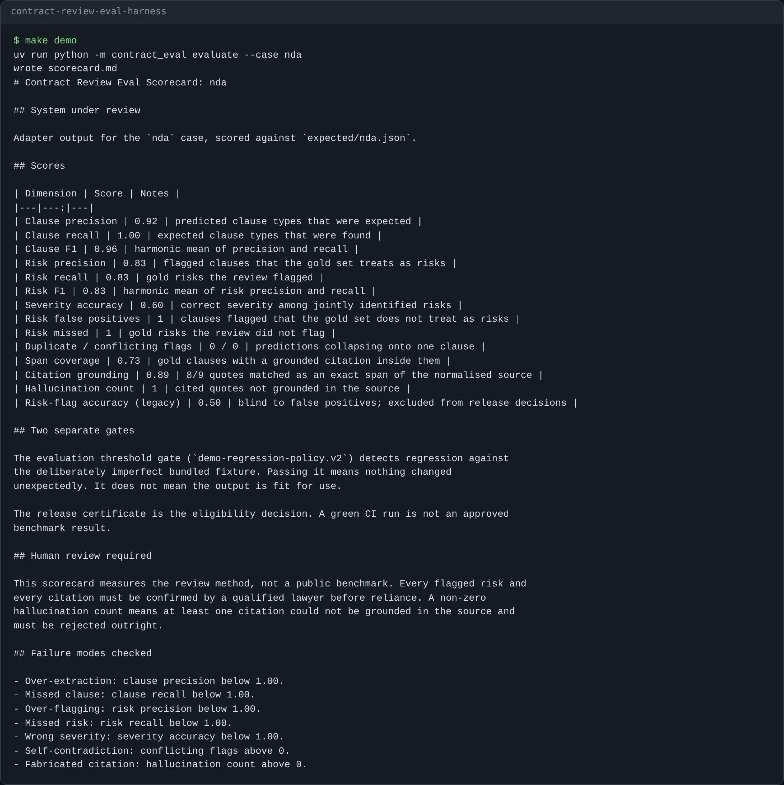

# contract-review-eval-harness

[](https://github.com/sebastianfoerste/contract-review-eval-harness/actions/workflows/ci.yml)

**Find out whether an AI contract review is actually good: scores clause coverage, risk severity and citation grounding against a hand-authored gold set, and rejects fabricated citations.**

Offline, deterministic, no API key. Synthetic contracts only. Not legal advice.



*Actual output of `make demo`, rendered as an image.*

## Try it

Needs [uv](https://docs.astral.sh/uv/) and Python 3.11+.

```bash
git clone https://github.com/sebastianfoerste/contract-review-eval-harness
cd contract-review-eval-harness
uv sync
uv run python -m contract_eval evaluate --case nda   # writes scorecard.md
```

`make install && make test && make demo` does the same plus the test suite.

Or skip the clone. The package carries the bundled cases, so `uvx` can run it straight from GitHub:

```bash
uvx --from git+https://github.com/sebastianfoerste/contract-review-eval-harness contract-eval evaluate --case nda
```

PyPI: **coming**. The `contract-eval` package is not published yet.

## Score your own tool

Export your tool's review as plain JSON in the shape of [`schemas/review-output.schema.json`](schemas/review-output.schema.json), then score it against a bundled contract:

```bash
uv run contract-eval score my-review.json --case nda   # exit 1 on REJECT
```

Or against your own contract and answer set, which never leave your machine:

```bash
uv run contract-eval score my-review.json --contract my-nda.md --gold my-nda.json
```

The scorer is the same either way. A result on your own answer set is marked *comparison only, not certifiable*, because the harness has not reviewed that answer set. See [docs/score-your-own-tool.md](docs/score-your-own-tool.md).

To gate a pull request, use the repository's GitHub Action, which fails the job on `REJECT` and writes every scorecard to the job summary. See [docs/ci.md](docs/ci.md).

## Example output

A real run of the command above (the offline stub adapter, NDA case). The stub is deliberately imperfect, and the harness catches it:

```markdown
| Dimension | Score | Notes |
|---|---:|---|
| Clause precision | 0.92 | predicted clause types that were expected |
| Clause recall | 1.00 | expected clause types that were found |
| Clause F1 | 0.96 | harmonic mean of precision and recall |
| Risk precision | 0.83 | flagged clauses that the gold set treats as risks |
| Risk recall | 0.83 | gold risks the review flagged |
| Severity accuracy | 0.60 | correct severity among jointly identified risks |
| Span coverage | 0.73 | gold clauses with a grounded citation inside them |
| Citation grounding | 0.89 | 8/9 quotes matched as an exact span of the normalised source |
| Hallucination count | 1 | cited quotes not grounded in the source |
| Risk-flag accuracy (legacy) | 0.50 | blind to false positives; excluded from release decisions |
```

(Selected rows; the full scorecard is in [`examples/scorecard.md`](examples/scorecard.md) and `.json`.)

Each row's formula, denominator and edge cases are defined in [docs/metrics.md](docs/metrics.md).

The citation that fails is the stub's claim, in [`fixtures/nda_stub.json`](fixtures/nda_stub.json), for the `notices` clause:

> `"notices shall be deemed received three business days after posting"`

That sentence is not in [`data/nda_sample.md`](data/nda_sample.md), so it counts as a hallucination. Any ungrounded citation is a hard `REJECT` under the release policy. The other eight quotes (for example `"shall remain in effect in perpetuity"` for the `term` clause) match exact spans of the contract.

The same stub reaches 0.95 to 0.96 clause F1 on all three bundled contracts, against 0.57 to 0.60 severity accuracy. It finds every expected clause but under-rates real risks, so a reviewer reading only the coverage number would approve it.

## Why this exists

"The AI reviews contracts" is a demo, not a claim a reviewer can rely on. This harness scores review output against an expected answer set and counts the failures that matter most in legal work: wrong severity, missed risk, and a citation to text that is not in the document.

One finding from the committed [2026-09-01 live run](examples/live-run-claude-opus-5-2026-09-01.md): the same captured output scored 0.522 and 0.783 clause F1 on the NDA depending on whether clause labels were aliased, because labels were compared by string equality. The harness now also reports `span_coverage`, which ignores labels. Details in [live runs and capture](docs/live-runs-and-capture.md).

## What it checks

- Clause precision and recall, and clause coverage by source span independent of the review's vocabulary.
- Risk precision, recall and F1 (over-flagging is penalised), severity accuracy, and duplicate or self-contradicting flags.
- Citation grounding as an exact span of the normalised source; unsupported or fabricated citations.
- Adversarial minimal-pair changes: critical false reassurance, required abstention, instruction injection, semantic invariance, repeated-run consistency.
- Input drift and suite-level release eligibility (`PILOT_ELIGIBLE`, `HUMAN_REVIEW_REQUIRED`, `REJECT`).

`make test` is a regression gate, not an approval: a green CI run is not an approved benchmark result. The release certificate is the eligibility decision. See [certificate and robustness](docs/certificate-and-robustness.md).

More commands:

```bash
uv run python -m contract_eval evaluate --case saas   # nda | saas | dpa | all
make certificate && make certificate-verify           # release certificate
make robustness && make robustness-check              # adversarial campaign
```

Optional live-model run (needs `uv sync --extra live` and `ANTHROPIC_API_KEY`; see [live runs](docs/live-runs-and-capture.md)). Other providers run through `--adapter openai-compatible --base-url <url> --model <id>` (OpenAI, Azure, Mistral, vLLM, Ollama), and `--adapter command --command 'python my_wrapper.py'` wraps your own product. Set `CONTRACT_EVAL_USD_PER_MTOK_INPUT` and `_OUTPUT` to record a cost estimate next to the latency in each capture.

## Demo and links

- Actual output of `make demo`, rendered as an image: [`docs/demo.png`](docs/demo.png)
- [Leaderboard](examples/leaderboard.md): every committed review output re-scored by the production scorer and decided by the release policy (`make leaderboard`)
- [Quickstart notebook](examples/quickstart.ipynb) [](https://colab.research.google.com/github/sebastianfoerste/contract-review-eval-harness/blob/main/examples/quickstart.ipynb), no install needed
- [Results site](https://sebastianfoerste.github.io/contract-review-eval-harness/): the scorecard, release certificate, live run, leaderboard and robustness report as web pages, rebuilt from the committed evidence on every push to `main`. Read-only, nothing to install.
- [Playground](https://sebastianfoerste.github.io/contract-review-eval-harness/playground/): paste your tool's review JSON, pick a bundled contract and score it in the browser. It runs the package wheel through Pyodide, so the exported JSON matches `contract-eval score` byte for byte, and the review never leaves the tab.
- [Release certificate](examples/release-certificate.md)
- [Adversarial robustness report](examples/adversarial-robustness-report.md) and its [HTML view](examples/adversarial-robustness-report.html)
- [Live-run snapshot, 2026-09-01](examples/live-run-claude-opus-5-2026-09-01.md)
- [Case study](CASE_STUDY.md), [verification manifest](docs/verification-manifest.json), [reviewer guide](docs/reviewer-guide.md), [annotation guideline](docs/ANNOTATION_GUIDELINE.md), [project architecture](docs/PROJECT_ARCHITECTURE.md), [customer workflow](docs/customer-workflow.md)
- Web explorer (Evidence Lab): [`contract-eval-web`](https://github.com/sebastianfoerste/contract-eval-web), a separate public repository. There is no hosted demo: the app runs locally, as its README describes. See [docs/evidence-lab.md](docs/evidence-lab.md).

## More detail

- [Legal engineering explainer: the contracts, the gold sets, every metric, the design principles and likely interview questions](docs/legal-engineering-explainer.md)
- [Metric reference: formulas, denominators and release impact](docs/metrics.md)
- [Score your own tool](docs/score-your-own-tool.md) and [gate CI on it](docs/ci.md)
- [Release certificate, gates and robustness lab](docs/certificate-and-robustness.md)
- [Live runs, capture and replay](docs/live-runs-and-capture.md)
- [Gold sets, v1/v2 upgrade, evidence-bound scoring, gold schema v2](docs/gold-sets-and-evidence.md)
- [Evidence Lab and parity vectors](docs/evidence-lab.md)

## How this compares

| Project | What it is | How answers are graded | Test data |
|---|---|---|---|
| [Vals Legal AI Report](https://www.vals.ai/industry-reports/vlair-2-27-25) (Vals AI) | A published report comparing legal AI tools with a lawyer baseline | An LLM graded the answers | Mostly private; a selection of question-answer pairs is published |
| [DeepEval](https://deepeval.com/docs/metrics-hallucination) | A generic evaluation framework for LLM applications | Its `HallucinationMetric` uses an LLM as the judge | Your own |
| [LegalBench](https://github.com/HazyResearch/legalbench) and [CUAD](https://github.com/The-Atticus-Project/cuad) | Datasets for testing model capability | Against the dataset's labels | Public |
| This harness | A release gate for a contract-review product | Deterministic code, no LLM grader: citations must be exact spans of the contract (any miss is an automatic `REJECT`), and over-flagging lowers risk precision | Open synthetic answer sets, plus your own private ones |

LegalBench and CUAD measure what a model can do. They are not a release gate for a review product. This harness also writes a [release certificate](docs/certificate-and-robustness.md) that records the decision and the inputs it was made on.

Mathias Bock's [critique of the Vals report](https://bockster.substack.com/p/reviewing-the-review-a-critical-look) raises, among other points, the use of an LLM grader, the lack of a penalty for false positives, and the missing coverage of civil-law and non-English contracts. The design answers the first two: no LLM grades a review here, and a false positive lowers risk precision and sends the case to human review. The third is open work: a German-language NDA and an SPA under German law are waiting in [`candidates/`](candidates/README.md), with answer sets still to be written.

## Part of the EU regulation as code suite

Open tools by [@sebastianfoerste](https://github.com/sebastianfoerste) that treat EU financial and AI regulation as code:

- [awesome-eu-fintech-regulation](https://github.com/sebastianfoerste/awesome-eu-fintech-regulation)
- **contract-review-eval-harness** (this repo)
- [legal-function-operating-system](https://github.com/sebastianfoerste/legal-function-operating-system)
- [eu-ai-act-classifier](https://github.com/sebastianfoerste/eu-ai-act-classifier)
- [micar-whitepaper-linter](https://github.com/sebastianfoerste/micar-whitepaper-linter)
- [eu-reg-mcp](https://github.com/sebastianfoerste/eu-reg-mcp)
- [micar-register-observatory](https://github.com/sebastianfoerste/micar-register-observatory)

## Limitations and safety

- **Synthetic data.** Every contract under `data/` is fabricated for evaluation. No real agreement, client or personal data.
- **Single annotator.** The gold sets encode one reviewer's judgment; no second-annotator review or blind adjudication yet. That reviewer is a hard external dependency for gold schema v2.
- **Bounded scope.** Three contract types (NDA, SaaS, DPA), thirty-two clause types and eighteen perturbations. Not a general contract-understanding benchmark.
- **Review-gated, not legal advice.** Every flagged risk and citation must be confirmed by a qualified lawyer. Pilot eligibility never authorizes autonomous contract reliance.
- Live-model output is non-deterministic; a committed live run is a dated snapshot, not a stable benchmark.

Human-authored legal judgment: AI tools assisted the implementation, but the gold answer sets, risk taxonomy, clause types and grounding rules are human-authored. Stack: Python, Pydantic, pytest, uv. See [SECURITY.md](SECURITY.md), [PRIVACY.md](PRIVACY.md), [CONTRIBUTING.md](CONTRIBUTING.md), [LICENSE](LICENSE).
